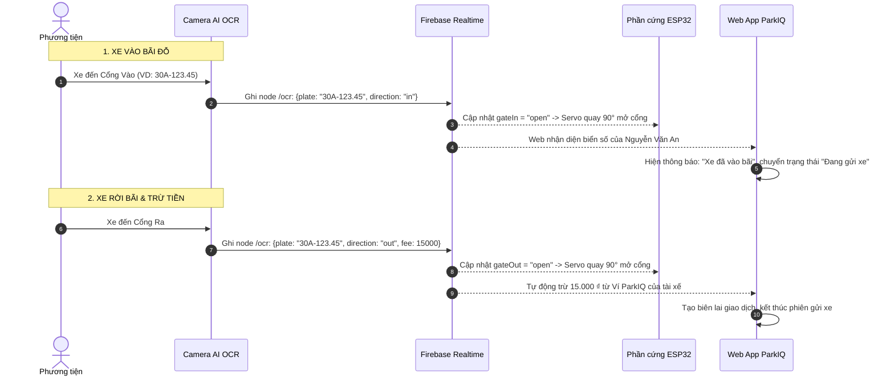
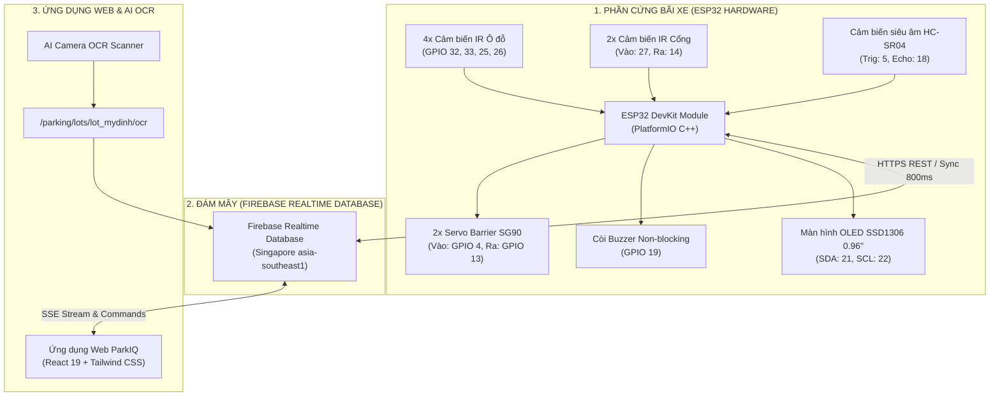

# 🚗 HỆ THỐNG BÃI ĐỖ XE THÔNG MINH (SMART PARKING SYSTEM)
### Dự án SIC IoT — Tích hợp Phần cứng ESP32, Nhận diện Biển số AI OCR, Firebase Realtime Database & React Web App

Hệ thống quản lý bãi đỗ xe thông minh hai chiều thời gian thực (Realtime Two-Way Sync):
- **Bãi đỗ xe thực tế:** **B7 Mỹ Đình** (`lot_mydinh`), quy mô mô hình 4 ô đỗ tiêu chuẩn.
- **Giám sát ô đỗ tự động:** 4 cảm biến hồng ngoại (IR) phát hiện xe đỗ và tính toán số chỗ trống tức thì.
- **Nhận diện biển số xe AI Camera OCR:** Đăng ký biển số phương tiện trên Web, hệ thống tự động quét biển số khi xe đến, mở barrier cổng vào, tính toán thời gian đỗ và tự động trừ tiền ví tài xế khi xe rời bãi.
- **Barrier thông minh chống chém xe:** Tự động mở khi xe đến cổng (hoặc mở từ xa qua Web), tự động đóng sau khi xe đi qua an toàn và **tuyệt đối không hạ cánh tay khi có xe dừng dưới cổng**.
- **Hỗ trợ lùi chuồng an toàn:** Cảm biến siêu âm HC-SR04 đo khoảng cách xe và còi Buzzer phi chặn (non-blocking) phát âm thanh cảnh báo khi đỗ quá sát tường ($\le 10cm$).
- **Màn hình OLED tại chỗ:** Hiển thị trực tiếp số chỗ trống, sơ đồ 4 ô đỗ và khoảng cách xe lùi.
- **Đồng bộ Đám mây 100%:** Dữ liệu chạy qua **Firebase Realtime Database**, cập nhật trực tiếp lên ứng dụng Web/Mobile.

---

## 👥 TÀI KHOẢN MẪU ĐỂ TEST & TRẢI NGHIỆM (PRESET TEST ACCOUNTS)

Hệ thống đã tích hợp sẵn 4 tài khoản thử nghiệm với mật khẩu dùng chung là **`123456`**. Trên trang Đăng nhập Web có sẵn các nút bấm 1-click để đăng nhập nhanh tức thì:

| STT | Họ và Tên | Tên đăng nhập / SĐT | Mật khẩu | Vai trò | Số dư ví ban đầu | Biển số xe mặc định | Phương tiện sở hữu |
| :---: | :--- | :---: | :---: | :---: | :---: | :---: | :--- |
| **1** | **Nguyễn Văn An** | **`0912345678`** | **`123456`** | **Tài xế** | **350.000 ₫** | **`30A-123.45`** | • `30A-123.45` (VinFast VF8 - Trắng)<br>• `29A-888.99` (Honda SH 150i - Đen) |
| **2** | **Trần Thị Bình** | **`0987654321`** | **`123456`** | **Tài xế** | **500.000 ₫** | **`51G-456.78`** | • `51G-456.78` (Honda CR-V - Đen)<br>• `59F-333.22` (Yamaha Grande - Trắng) |
| **3** | **Phạm Tuấn Anh** | **`0933445566`** | **`123456`** | **Tài xế** | **200.000 ₫** | **`30H-888.66`** | • `30H-888.66` (Toyota Cross - Bạc) |
| **4** | **Lê Hoàng Nam** | **`0909999999`** | **`123456`** | **Chủ bãi** | **1.500.000 ₫** | **`29B-999.88`** | • `29B-999.88` (Mazda CX-5 - Đỏ) |

> [!TIP]
> **Đăng nhập số điện thoại tùy chọn:** Bạn cũng có thể nhập bất kỳ số điện thoại nào khác kèm mật khẩu `123456`, hệ thống sẽ tự động tạo tài khoản tài xế mới với số dư ban đầu 200.000 ₫!

---

## 🚘 QUY TRÌNH ĐĂNG KÝ XE & QUÉT BIỂN SỐ AI OCR TÍNH TIỀN TỰ ĐỘNG

### 1. Đăng ký phương tiện trên Web:
1. Đăng nhập bằng tài khoản tài xế (VD: `0912345678` / `123456`).
2. Vào mục **Cá nhân** hoặc trang chủ $\rightarrow$ chọn **Xe của tôi** (đường dẫn: `/driver/vehicles`).
3. Bấm **"Đăng ký thêm biển số xe mới"** (`/driver/vehicles/add`).
4. Nhập biển số (VD: `29A-686.88`), chọn loại xe, hãng xe, màu sắc và nhấn **Xác nhận đăng ký**.
5. Xe sẽ lập tức được lưu vào hệ sinh thái ParkIQ và gắn cờ `● AI Camera: Sẵn sàng nhận diện`.

### 2. Luồng tự động khi xe vào / ra bãi đỗ:



---

## 🎮 HƯỚNG DẪN DEMO ĐIỀU KHIỂN XE (BẢNG ĐIỀU KHIỂN & OCR SCRIPT)

Dự án đã tích hợp sẵn các công cụ để bạn có thể thuyết trình toàn diện luồng dữ liệu thời gian thực:

### Cách 1: Sử dụng Bảng Điều Khiển Terminal (`dieu_khien_xe.bat`)
1. Click đúp file: **`scripts/dieu_khien_xe.bat`** (hoặc mở terminal gõ: `python scripts/demo_controller.py`).
2. Màn hình Terminal tương tác hiện lên với các lệnh chuyên nghiệp:

| Lệnh | Ý nghĩa & Thao tác hệ thống |
| :---: | :--- |
| **`v1`** | **Xe 1 VÀO:** Quét biển số `30A-123.45` (VinFast VF8 - An) $\rightarrow$ Đỗ Ô 1 $\rightarrow$ Mở Cổng Vào $\rightarrow$ Web hiện thông báo nhận diện xe của An. |
| **`r1`** | **Xe 1 RA:** Biển số `30A-123.45` rời bãi $\rightarrow$ Trống Ô 1 $\rightarrow$ Mở Cổng Ra $\rightarrow$ **Web tự động trừ 15.000 ₫ trong Ví của An!** |
| **`v2`** | **Xe 2 VÀO:** Quét biển số `51G-456.78` (Honda CR-V - Bình) $\rightarrow$ Đỗ Ô 2 $\rightarrow$ Mở Cổng Vào. |
| **`r2`** | **Xe 2 RA:** Biển số `51G-456.78` rời bãi $\rightarrow$ Trống Ô 2 $\rightarrow$ Mở Cổng Ra $\rightarrow$ **Web tự động trừ 20.000 ₫ trong Ví của Bình!** |
| **`v3`** | **Xe 3 VÀO:** Quét biển số `30H-888.66` (Toyota Cross - Anh) $\rightarrow$ Đỗ Ô 3 $\rightarrow$ Mở Cổng Vào. |
| **`r3`** | **Xe 3 RA:** Biển số `30H-888.66` rời bãi $\rightarrow$ Trống Ô 3 $\rightarrow$ Mở Cổng Ra $\rightarrow$ **Web tự động trừ 15.000 ₫!** |
| **`ocr`** | **Quét biển số tùy chọn:** Cho phép bạn gõ bất kỳ biển số xe nào (VD biển số bạn vừa đăng ký trên Web) $\rightarrow$ Chọn Vào/Ra $\rightarrow$ Nhập số tiền $\rightarrow$ Hệ thống lập tức xử lý và Web hiển thị ngay! |
| **`1` - `4`** | Bấm số 1, 2, 3 hoặc 4 để Cho xe vào / xe ra ô đỗ tương ứng. |
| **`in`** / **`out`** | Mở thanh chắn barrier Cổng Vào / Cổng Ra. |
| **`d1` / `d2` / `d3`** | Đổi khoảng cách siêu âm: Xa (45cm) / Vừa (18cm) / Sát tường (7cm - **Kích hoạt còi Buzzer kêu**). |
| **`c`** / **`f`** | Dọn sạch bãi xe (Trống 4/4) / Lấp đầy bãi xe (Hết chỗ 0/4). |

### Cách 2: Điều khiển trực tiếp trên Web UI
1. Chạy file: `scripts/run_frontend.bat` (hoặc mở terminal: `cd frontend && npm run dev`).
2. Mở trình duyệt vào trang: **`http://localhost:5173/owner/gate`** (mục *Cổng IoT* của Chủ bãi).
3. **Thao tác ngay trên màn hình:**
   - **Bấm vào các nút quét AI OCR:** Có sẵn các nút quét nhanh `30A-123.45`, `51G-456.78`, `30H-888.66` hoặc ô nhập biển số tùy chọn.
   - **Click chuột vào Ô 1, 2, 3, 4:** Ô đỗ lập tức đổi sang màu **ĐỎ (Có xe 🚗)** hoặc **XANH (Trống 🅿️)**, số chỗ trống tự động trừ/cộng tức thì *(lệnh ghi thẳng lên Firebase thật)*.
   - **Click nút "Sát tường (7cm)":** Khoảng cách lập tức cập nhật và nhấp nháy đỏ **`🚨 CÒI KÊU BÁO ĐỘNG!`**.
   - **Click "Mở cổng vào" / "Mở cổng ra":** Cánh tay barrier quay mở góc 90° và tự động đóng lại sau khi hết thời gian.

### Cách 3: 1-Click mở toàn bộ hệ thống (`start_demo.bat`)
Chỉ cần click đúp file: **`scripts/start_demo.bat`**
- Hệ thống tự động: Bật bộ kết nối Firebase $\rightarrow$ Bật Web Server $\rightarrow$ Mở trình duyệt vào trang Quản lý bãi xe.

---

## 🏗️ Kiến Trúc Hệ Thống (System Architecture)



---

## 🔌 Bảng Sơ Đồ Đấu Nối Chân ESP32 (Hardware Pinout)

> [!IMPORTANT]
> **Lưu ý phần cứng sống còn:** Chân điều khiển Servo Cổng Vào được cắm vào **GPIO 4** (thay vì GPIO 12 trước đây là Strapping Pin MTDI dễ gây bootloop treo chip ESP32). Nguồn 5V của 2 động cơ Servo nên cấp nguồn ngoài và **nối chung GND** với ESP32.

| STT | Thiết bị ngoại vi | Chân linh kiện | Chân cắm trên ESP32 | Ghi chú |
| :---: | :--- | :---: | :---: | :--- |
| **1** | Màn hình OLED SSD1306 | `VCC` / `GND` | `3.3V` / `GND` | Nguồn 3.3V an toàn cho màn hình |
| | | `SDA` | **`GPIO 21`** | Giao tiếp I2C Data |
| | | `SCL` | **`GPIO 22`** | Giao tiếp I2C Clock |
| **2** | Cảm biến IR Ô đỗ 1 | `OUT` | **`GPIO 32`** | Mức LOW = Có xe, HIGH = Trống |
| **3** | Cảm biến IR Ô đỗ 2 | `OUT` | **`GPIO 33`** | Mức LOW = Có xe, HIGH = Trống |
| **4** | Cảm biến IR Ô đỗ 3 | `OUT` | **`GPIO 25`** | Mức LOW = Có xe, HIGH = Trống |
| **5** | Cảm biến IR Ô đỗ 4 | `OUT` | **`GPIO 26`** | Mức LOW = Có xe, HIGH = Trống |
| **6** | Cảm biến IR Cổng Vào | `OUT` | **`GPIO 27`** | Đặt trước thanh chắn cổng vào |
| **7** | Cảm biến IR Cổng Ra | `OUT` | **`GPIO 14`** | Đặt trước thanh chắn cổng ra |
| **8** | **Servo Barrier Cổng Vào** | **Dây cam (PWM)** | **`GPIO 4`** | **Mở 90° / Đóng 0° (Tránh GPIO 12)** |
| **9** | **Servo Barrier Cổng Ra** | Dây cam (PWM) | **`GPIO 13`** | Mở 90° / Đóng 0° |
| **10** | Cảm biến siêu âm HC-SR04 | `TRIG` | **`GPIO 5`** | Phát xung siêu âm |
| | | `ECHO` | **`GPIO 18`** | Nhận xung phản hồi |
| **11** | Còi báo động Buzzer | Cực dương (+) | **`GPIO 19`** | Cực âm (-) nối GND |

---

## ☁️ Cấu Trúc Dữ Liệu Firebase Realtime Database

Dữ liệu bãi xe được đồng bộ tại node `/parking/lots/lot_mydinh`:

```json
{
  "parking": {
    "lots": {
      "lot_mydinh": {
        "status": {
          "lotId": "lot_mydinh",
          "lotName": "B7 My Dinh",
          "totalSlots": 4,
          "freeSlots": 3,
          "distance": 24.5,
          "lastHeartbeat": 1726145678000,
          "slots": {
            "1": false,
            "2": true,
            "3": false,
            "4": false
          },
          "gates": {
            "in": "closed",
            "out": "closed"
          }
        },
        "commands": {
          "gateIn": "idle",
          "gateOut": "idle"
        },
        "ocr": {
          "plate": "30A-123.45",
          "direction": "out",
          "timestamp": 1726145678000,
          "vehicleName": "VinFast VF8",
          "slot": 1,
          "fee": 15000
        }
      }
    }
  }
}
```

* **URL Firebase chính thức của dự án:**
  `https://smartparking-139b7-default-rtdb.asia-southeast1.firebasedatabase.app/`
* **Quy tắc bảo mật (Security Rules):**
  ```json
  {
    "rules": {
      ".read": true,
      ".write": true
    }
  }
  ```

---

## 🔌 HƯỚNG DẪN NẠP CODE CHO ESP32 THẬT

1. **Cấu hình WiFi:**
   Mở file [firmware/include/config.h](file:///f:/smartparking/SmartParkingSystem_SIC_IOT/firmware/include/config.h), điền WiFi nơi bạn đang ngồi:
   ```cpp
   #define WIFI_SSID     "Ten_WiFi_Cua_Ban"
   #define WIFI_PASSWORD "Mat_Khau_WiFi"
   ```
2. **Đấu nối linh kiện:** Cắm dây theo đúng bảng **Sơ đồ đấu nối chân ESP32** ở trên.
3. **Nạp code (1-Click):**
   - Cắm cáp Micro-USB từ ESP32 vào máy tính.
   - Click đúp chạy file: **`scripts/upload_firmware.bat`** *(hoặc lệnh `pio run -t upload` trong `firmware/`)*.
4. **Vận hành thực tế:**
   - Màn hình OLED trên ESP32 sáng chữ: `B7 My Dinh [IoT]`.
   - Che tay vào cảm biến Ô 1 $\rightarrow$ OLED cập nhật `S1:X`, trên Web lập tức đổi sang màu ĐỎ.
   - Bấm nút "Mở cổng" trên Web $\rightarrow$ Cánh tay Servo trên bàn quay mở 90° và tự động đóng lại!

---

## 📁 Thư Mục Tiện Ích (`scripts/`)

| Tên tệp | Chức năng |
| :--- | :--- |
| **`xem_log_firebase.bat`** | **Xem Live Log thời gian thực từ Firebase:** Hiển thị tức thì mọi sự kiện xe vào/ra, OCR, mở barrier, còi kêu từ Terminal |
| **`xem_log_esp32.bat`** | **Xem Log Serial trực tiếp từ chip ESP32:** Đọc dữ liệu debug 115200 baud qua cáp USB |
| **`dieu_khien_xe.bat`** | Mở **bảng điều khiển Terminal tương tác** (quét OCR `v1`-`r3`, `ocr`, đổi slot `1`-`4`, mở barrier `in`/`out`, chỉnh khoảng cách `d1`-`d3`) |
| **`run_frontend.bat`** | Khởi động máy chủ giao diện Web Frontend (Vite) tại `http://localhost:5173` |
| **`start_demo.bat`** | **1-Click khởi động toàn bộ demo** (ESP32 Simulator + Web Server + Mở trình duyệt) |
| **`upload_firmware.bat`** | **1-Click biên dịch và nạp code** trực tiếp vào kit ESP32 qua cáp USB |
| **`build_firmware.bat`** | Biên dịch kiểm tra code C++ của ESP32 bằng PlatformIO |
| **`test_firebase.py`** | Kiểm tra đường truyền và tính sẵn sàng của Firebase Realtime Database |
| **`demo_controller.py`** | Script Python điều khiển xe vào/ra và kích hoạt quét biển số OCR |
| **`log_viewer.py`** | Trình đọc và hiển thị luồng nhật ký sự kiện thời gian thực từ Firebase |

---

## 🎯 Tổng Kết Các Cải Tiến Kỹ Thuật Đã Hoàn Thiện

1. **Quét Biển Số AI OCR & Trừ Tiền Tự Động:** Tích hợp node `/ocr` trên Firebase Realtime Database. Khi xe ra bãi, hệ thống đối soát biển số xe đã đăng ký, tự động trừ tiền vào Ví ParkIQ và ghi nhận biên lai giao dịch.
2. **Thông Báo Thời Gian Thực (OCR Banner):** Giao diện Web hiển thị ngay biểu ngữ thông báo khi có sự kiện quét biển số tại Cổng Vào / Cổng Ra.
3. **Quản Lý & Đăng Ký Phương Tiện:** Hỗ trợ người dùng đăng ký nhiều xe (ô tô, xe máy) và chuyển đổi xe mặc định.
4. **Hệ Thống Đa Người Dùng Thực Tế:** 4 tài khoản mẫu (Nguyễn Văn An, Trần Thị Bình, Phạm Tuấn Anh, Lê Hoàng Nam) với số dư ví và phương tiện độc lập, lưu trữ bền vững qua `localStorage`.
5. **Khắc phục lỗi Strapping Pin:** Chuyển `SERVO_IN_PIN` sang `GPIO 4`, loại bỏ hoàn toàn nguy cơ bootloop và hỏng flash ESP32.
6. **Khử Delay làm đông cứng CPU:** Viết lại toàn bộ hàm `Buzzer_Update` dùng timer `millis()`, giải phóng CPU hoàn toàn.
7. **Cơ chế Barrier an toàn chống chém xe:** Bổ sung logic kiểm tra cảm biến: Hết 4s mở, nếu xe vẫn còn đứng chắn cổng thì tiếp tục giữ mở, không hạ cánh tay đè vào nóc xe.
8. **Xóa sạch Mock Data:** Loại bỏ toàn bộ các bãi xe 120 chỗ, 200 chỗ ảo; toàn bộ hệ thống chạy 100% dữ liệu thật đồng bộ qua Firebase Realtime Database.
